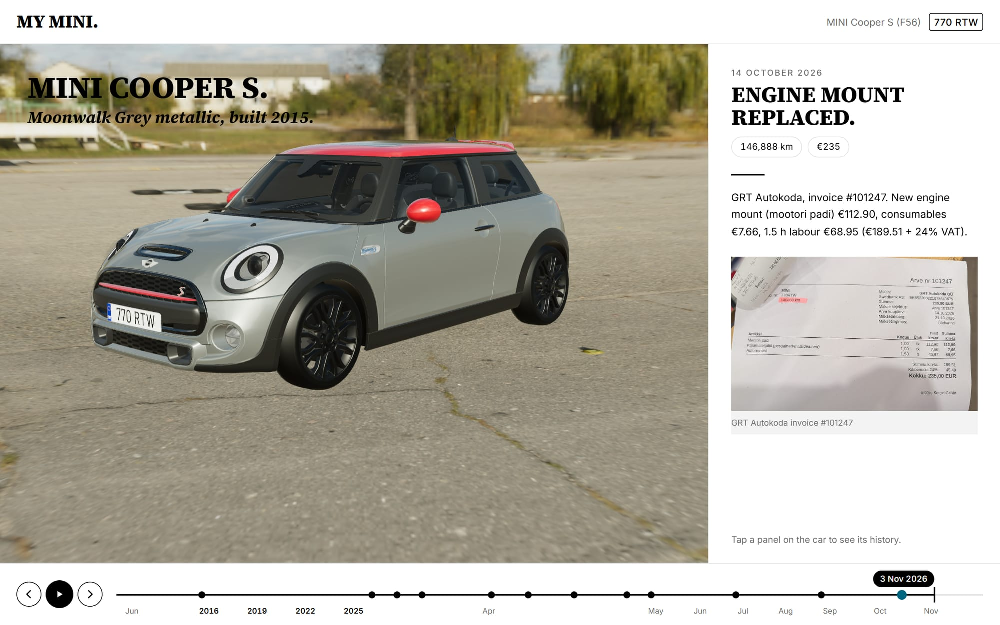
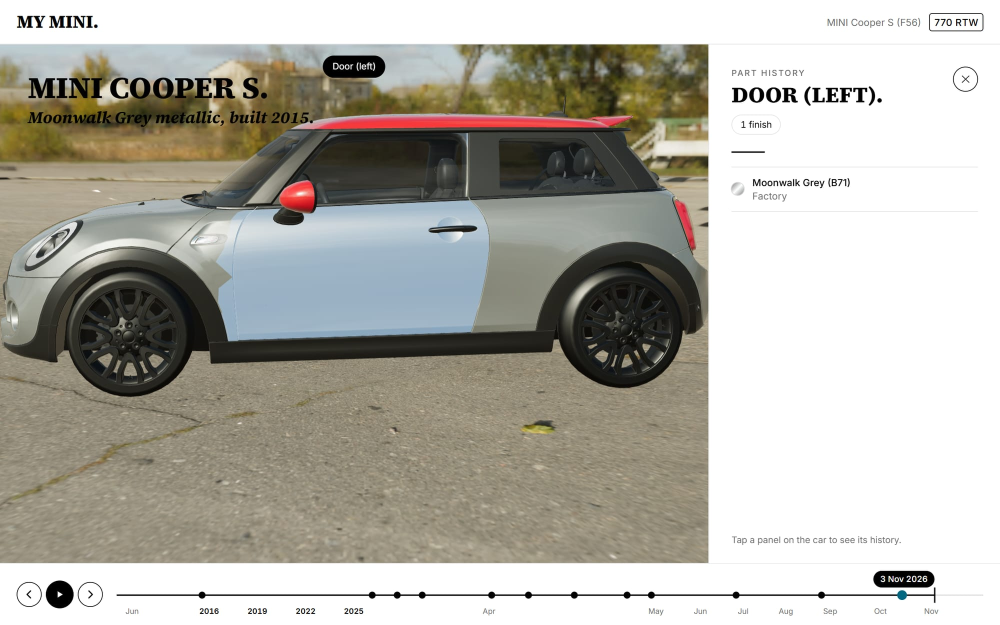
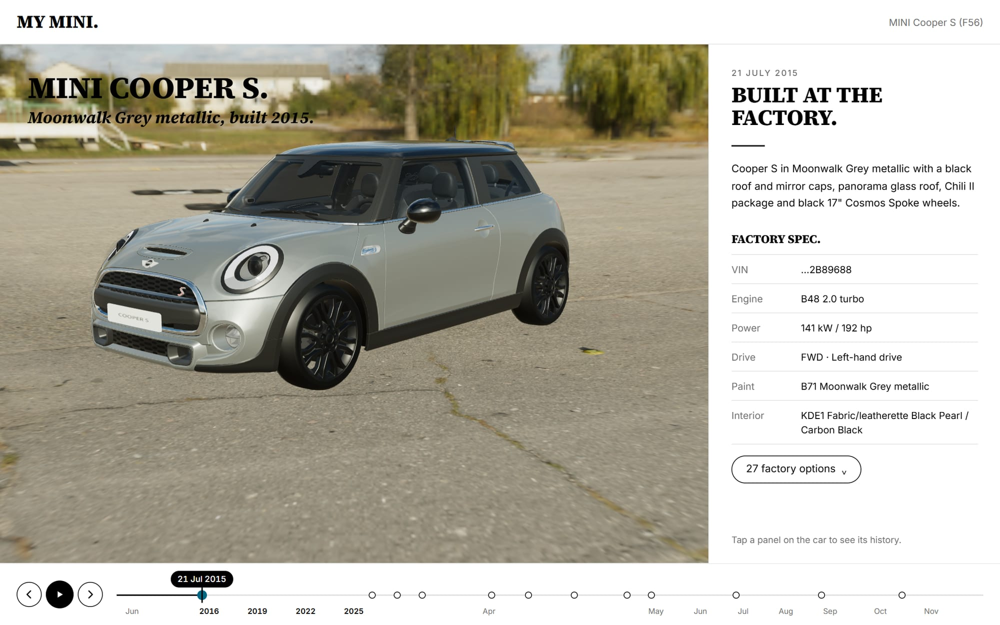
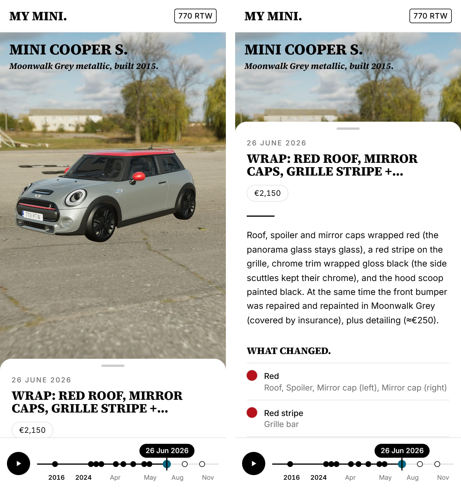

<div align="center">

# MY MINI.

***Every panel, plate and invoice — on one timeline.***

An interactive 3D history of one MINI Cooper S (F56). Drag through time and the car changes in front of you:<br>
wraps, repaints, dechromes and number plates appear on the right date, with the receipts beside them.

<br>


<br>

### [**→ Open the live app**](https://mini-chronicle.vercel.app)

<sub>Starts at the factory in 2015 — press <kbd>▶</kbd> to drive through the car's whole life.</sub>

<br>



</div>

<br>

## THE CAR, THEN AND NOW.

*Same car, same camera — left: March 2026, the day it left Belgium. Right: today.*


Scrub the timeline and every part animates to the finish it had on that day. The car is not a set of
pre-made variants — its look is **derived**: factory spec, plus every event up to the cursor.

| | |
|---|---|
| **Wrap** | Roof, spoiler and mirror caps in red; the panorama glass stays glass |
| **Dechrome** | Grille surround, window line, door handles, taillight rings, fuel cap → gloss black. Side scuttles keep their chrome |
| **Paint** | Hood scoop painted black, masked per-pixel on the bonnet |
| **Accents** | Red stripe on the grille bar |
| **Repairs** | Front bumper repainted (insurance), rear bumper repainted by the previous owner |

<br>

## PLATES, ON THE RIGHT DATE.

*Red Belgian transit plates for the drive home. Estonian plates from registration day on.*


Plates are drawn live onto the model at true EU proportions (520 × 110 mm) — blue band, ring of stars,
country code and DIN-style characters. A new plate is one line in the timeline file.

<br>

## THE DETAILS THAT MAKE IT MINE.

*The sport roof spoiler instead of the base ducktail. The painted scoop. Pre-facelift DRLs.*


The stock 3D model was rebuilt to match the real car: the single body mesh split into **35 recolourable
parts**, the half-lit LED rings of the pre-LCI headlights, a sport spoiler transplanted from a JCW model,
no front plate holder, and the lost badges and interior restored.

<br>

## TAP A PANEL. SEE ITS STORY.



Hover to identify any part, click it for its full history — every finish it has worn and the event that
changed it. Click an entry to jump the timeline there.

<br>

## WHERE IT ALL BEGAN.



The first entry is the factory build sheet: engine, paint code, upholstery and all 27 option codes.
Every service, repair and receipt after that comes with its mileage, its cost and a photo of the invoice.

<br>

## MADE FOR THE PHONE IN YOUR POCKET.

<table>
<tr>
<td width="46%"></td>
<td>

- **A bottom sheet**, not a page. Collapsed it shows the date, the headline and the numbers; tap or swipe for the full story.
- **No jumping.** Fixed full-screen layout on the stable `svh` viewport — the address bar can come and go, the car stays put.
- **Thumb-sized timeline.** The whole strip is the touch target, snaps to entries within finger reach, never scrolls the page.
- **Reframed for portrait.** Wider lens, camera pulled back, car lifted above the sheet.

</td>
</tr>
</table>

<br>

---

<br>

## HOW IT WORKS.

```text
content/timeline.json  ──►  zod validation  ──►  deriveState(timeline, date)  ──►  three.js materials
   factory spec                                    factory look                       animated per part
   + dated events                                  + every event ≤ date               + plate texture
```

**One file holds the whole history.** Each event is a date, a title, a story, photos — and optionally
the parts it changed and the plates it fitted:

```jsonc
{
  "id": "wrap",
  "date": "2026-06-26",
  "title": "Wrap: red roof, mirror caps, grille stripe + dechrome",
  "tags": ["wrap"],
  "costEur": 2150,
  "parts": {
    "roof":         { "color": "#b5121b", "finish": "gloss", "label": "Red" },
    "@mirror_caps": { "color": "#b5121b", "finish": "gloss", "label": "Red" },
    "hood_scoop":   { "color": "#0b0b0c", "finish": "gloss", "label": "Black (painted)" }
  }
}
```

Aliases like `@body`, `@chrome` and `@mirror_caps` cover several parts at once. Finishes are
`gloss`, `metallic`, `satin`, `matte`, `chrome`, `glass` and `emissive`. Unknown part names fail the build.

### The model pipeline

```bash
npm run model:convert   # FBX → raw GLB (FBX2glTF)
npm run model:build     # raw GLB → public/models/f56.glb (35 named parts)
```

`scripts/build-model.mjs` turns a generic F56 into this specific car: it scales and renames the source,
splits paint by mesh connectivity and UV islands, mirrors the right door's outline to cut the left one,
separates chrome by its palette cell, fixes the FBX transparency bugs, swaps the spoiler, resizes the
plates to EU format and removes the plate holder. `/debug/model` shows every part in its own colour.

<br>

## RUN IT.

Live at **[mini-chronicle.vercel.app](https://mini-chronicle.vercel.app)**. To run it locally:

```bash
npm install
npm run dev            # http://localhost:3000
```

| Link | Opens |
|---|---|
| `/` | the car as it was built (21 July 2015) |
| `/?t=2026-03-10` | the car on a given date |
| `/?view=front` | a camera preset: `front` `rear` `left` `right` `top` `plate` `plate_rear` `scoop` `spoiler` `spoiler_close` |
| `/debug/model` | the part map |

Keyboard: <kbd>←</kbd> <kbd>→</kbd> jump between entries · <kbd>Space</kbd> plays the whole history.

`npm run screenshots` regenerates the images in this README from the running app.

<br>

## STACK.

**Next.js 16** (App Router, Turbopack) · **React 19** · **three.js** with **@react-three/fiber** and **drei** ·
**zustand** · **zod** · **date-fns** · **Tailwind CSS v4** · **glTF-Transform** for the model pipeline ·
**Puppeteer** for visual checks.

The interface follows the MINI brand language — heavy uppercase serif headlines that end in a full stop,
italic sublines, short black rules, black-outlined pill buttons, white space and one teal accent.

<br>

## CREDITS.

- Environment: **[Driving School](https://polyhaven.com/a/driving_school)** HDRI by Poly Haven — CC0.
- Sport roof spoiler geometry: **[2018 Mini John Cooper Works](https://sketchfab.com/3d-models/2018-mini-john-cooper-works-512f4b36c4204ebc99670c936bdf7566)** by ddiaz-design — CC BY-NC-SA 4.0.
- Fonts: Source Serif 4 and Inter (SIL OFL), Barlow Semi Condensed for plates (SIL OFL).

> A personal, non-commercial project. MINI is a trademark of BMW AG; this project is not affiliated with or endorsed by BMW or MINI.

<br>

<div align="center">

***Manche fahren Auto. Andere fahren MINI.***

</div>
